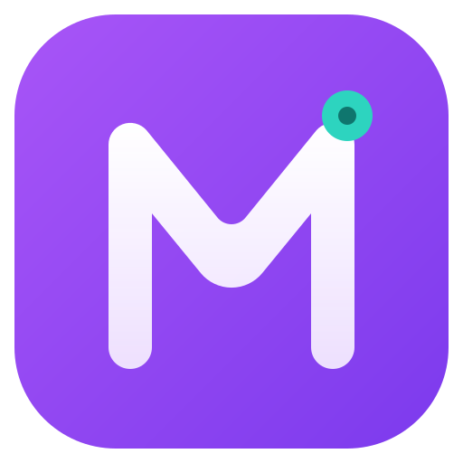
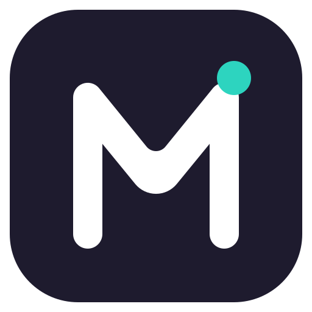
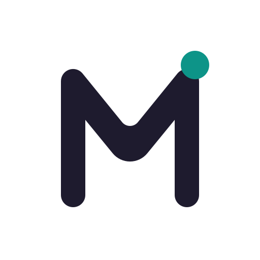
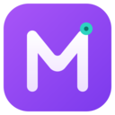
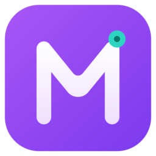
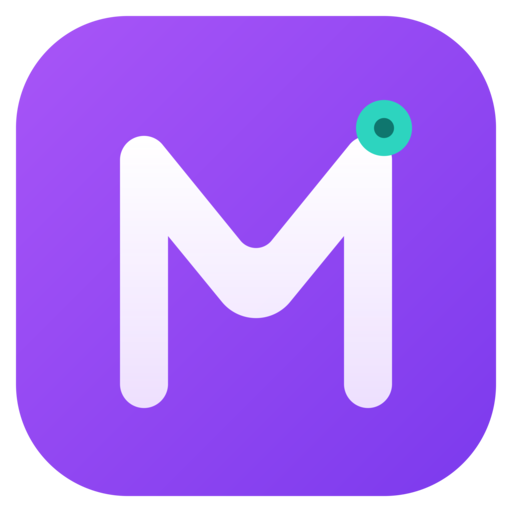
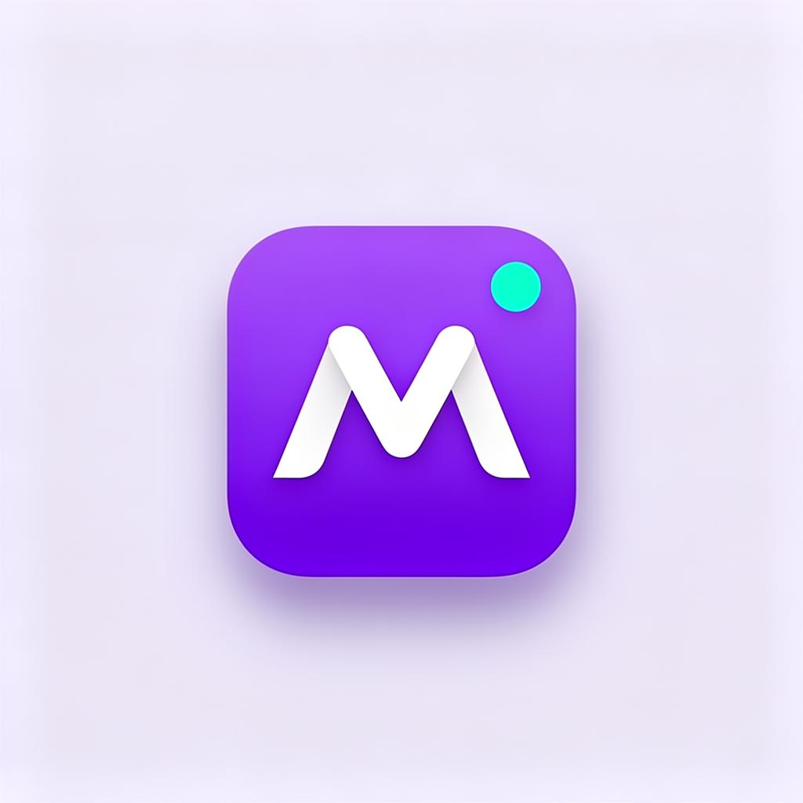
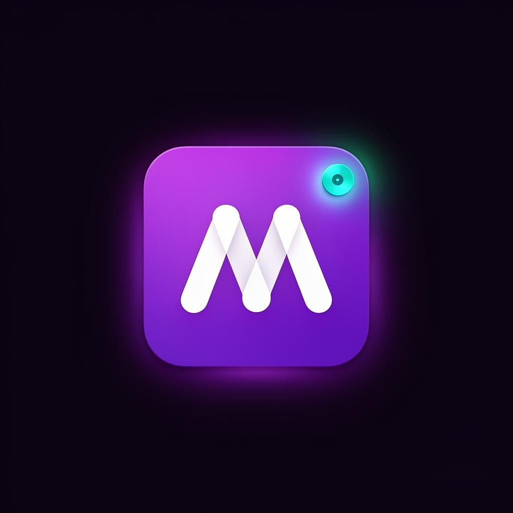
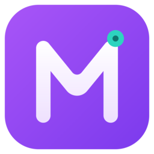

# 01 — MeetRecorder

> Browser extension for recording meetings, screens, and tabs. Modern, friendly, tech-forward.

## Overview
- **Name:** MeetRecorder
- **Idea:** A one-click browser extension to record meetings, screens, and tab audio.
- **Voice/Tone:** Modern, friendly, tech-forward, trustworthy.
- **Identity:** Bold geometric **M** in white on a vibrant purple gradient app-tile, with a small teal record dot signaling "ready to capture."

## Logo Variants

| Primary | Dark | White |
|---|---|---|
|  |  |  |

## Image Samples

### Icon set
| 52 | 128 | 256 | 512 |
|---|---|---|---|
|  |  |  |  |

### Mockups
| Light background | Dark background |
|---|---|
|  |  |

## Color Palette
See [`colors-themes/Palette.md`](colors-themes/Palette.md).

| Token | HEX |
|---|---|
| Primary | `#A855F7` |
| PrimaryGlow | `#7C3AED` |
| Background | `#1E1B2E` |
| Foreground | `#F5F3FF` |
| Accent (record) | `#2DD4BF` |

## Theme Tokens
Flat PascalCase tokens in [`colors-themes/Tokens.json`](colors-themes/Tokens.json) — drop into any design-system loader.

## Favicon
Per-project favicon, also mirrored to repo root.



## Usage
```tsx
import Logo from "./icons-svg/Logo.svg?react";
import LogoDark from "./icons-svg/Logo-Dark.svg?react";
import LogoWhite from "./icons-svg/Logo-White.svg?react";
import tokens from "./colors-themes/Tokens.json";
```

Pair the `Primary → PrimaryGlow` gradient on dark `Background`, and reserve `Accent` exclusively for the active-recording indicator.
