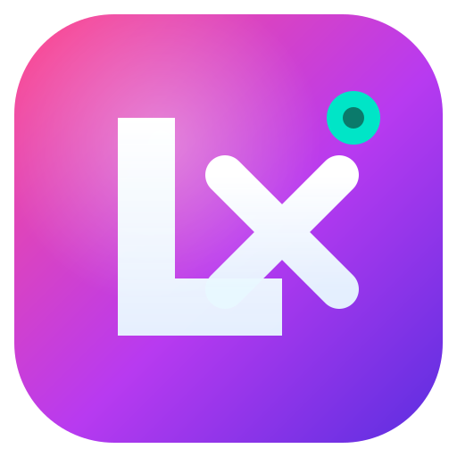
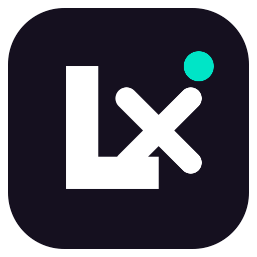
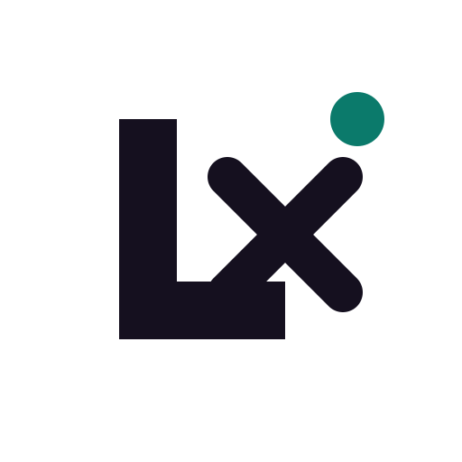
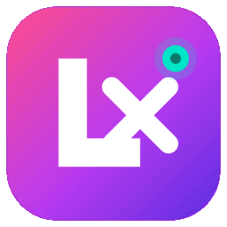
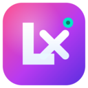
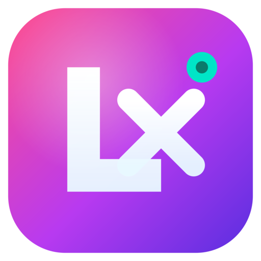
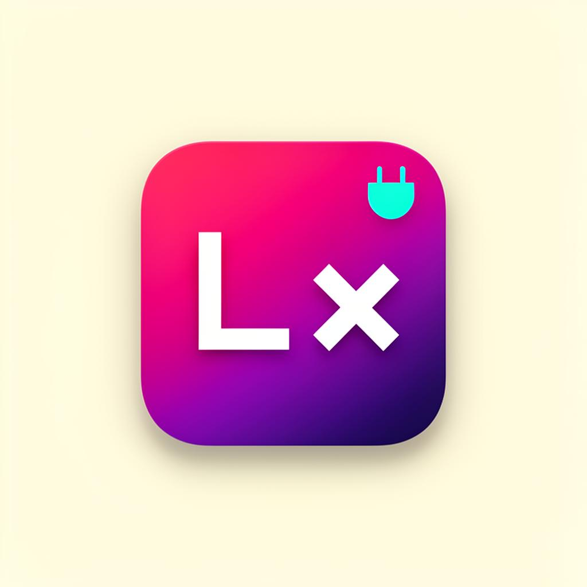
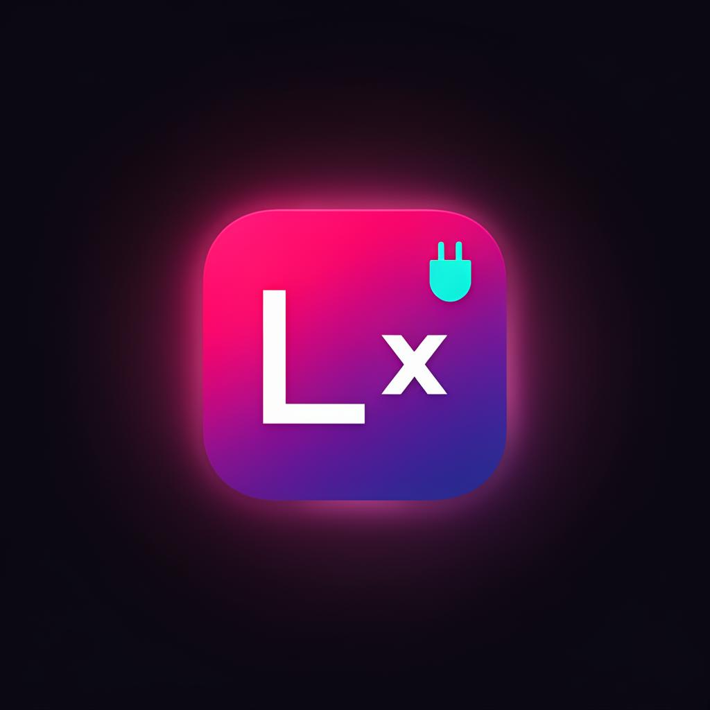

# 02 — LVEXT (Lovable Extension)

> Browser extension brand for **Lovable Extension** — bold, vibrant, dev-tool energy.

## Overview
- **Name:** LVEXT
- **Idea:** Browser extension powered by Lovable.
- **Voice/Tone:** Vibrant, modern, dev-tool, confident.
- **Identity:** A bold **L + X** monogram on a hot-pink → violet → indigo gradient tile, with a cyan-teal "plug" dot signaling extension/connection.

## Logo Variants

| Primary | Dark | White |
|---|---|---|
|  |  |  |

## Animation



## Image Samples

### Icon set
| 52 | 128 | 256 | 512 |
|---|---|---|---|
|  |  |  |  |

### Mockups
| Light background | Dark background |
|---|---|
|  |  |

## Color Palette
See [`colors-themes/Palette.md`](colors-themes/Palette.md).

| Token | HEX |
|---|---|
| Primary | `#FF4D8D` |
| PrimaryGlow | `#B83AF0` |
| PrimaryDeep | `#5B2EE0` |
| Background | `#15101F` |
| Foreground | `#FFFFFF` |
| Accent (plug) | `#00E5C7` |

## Theme Tokens
Flat PascalCase tokens in [`colors-themes/Tokens.json`](colors-themes/Tokens.json).

## Favicon


## Usage
```tsx
import Logo from "./icons-svg/Logo.svg?react";
import LogoDark from "./icons-svg/Logo-Dark.svg?react";
import LogoWhite from "./icons-svg/Logo-White.svg?react";
import tokens from "./colors-themes/Tokens.json";
```

Pair the `Primary → PrimaryGlow → PrimaryDeep` gradient on the `Background` surface, and reserve `Accent` for the extension/connection indicator.
