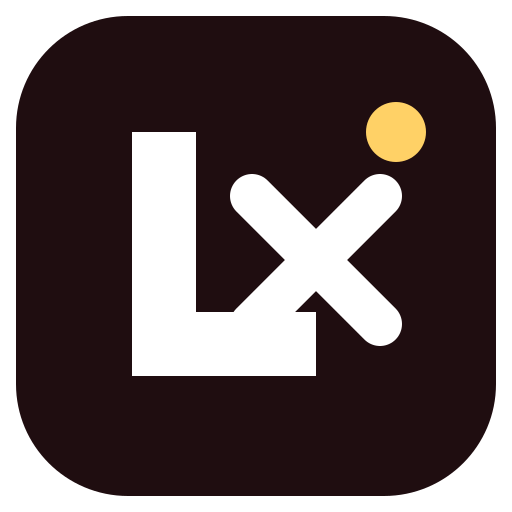
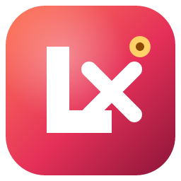
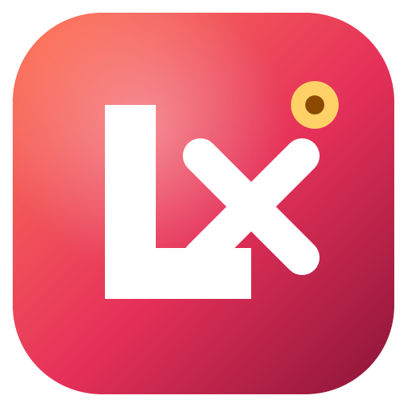
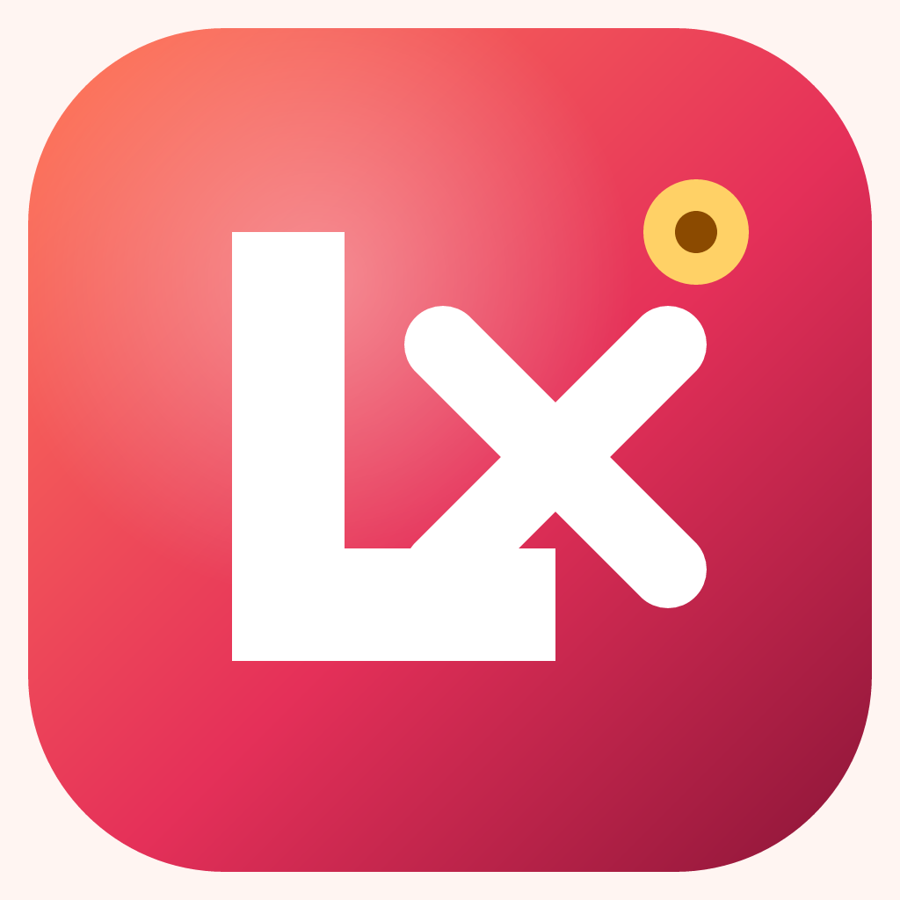
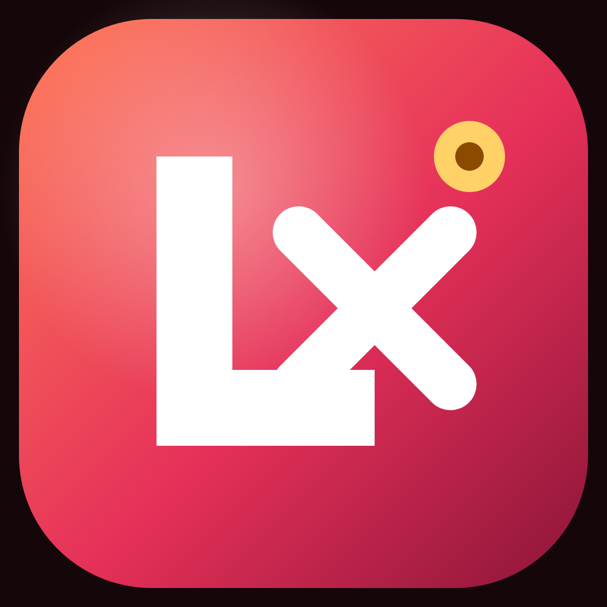

# 03 — LVEXT (Reddish)

> Warm, fiery variant of the **Lovable Extension** mark — coral → crimson → wine with a golden plug.

## Overview
- **Name:** LVEXT (Reddish)
- **Idea:** Browser extension powered by Lovable — warm/energetic palette.
- **Voice/Tone:** Bold, warm, energetic, confident.

## Logo Variants

| Primary | Dark | White |
|---|---|---|
|  |  |  |

## Image Samples

### Icon set
| 52 | 128 | 256 | 512 |
|---|---|---|---|
|  |  |  |  |

### Mockups
| Light background | Dark background |
|---|---|
|  |  |

## Color Palette
See [`colors-themes/Palette.md`](colors-themes/Palette.md).

| Token | HEX |
|---|---|
| Primary | `#E53059` |
| PrimaryGlow | `#FF7A59` |
| PrimaryDeep | `#8B1538` |
| Background | `#1F0D10` |
| Accent | `#FFD166` |

## Theme Tokens
[`colors-themes/Tokens.json`](colors-themes/Tokens.json)

## Favicon

